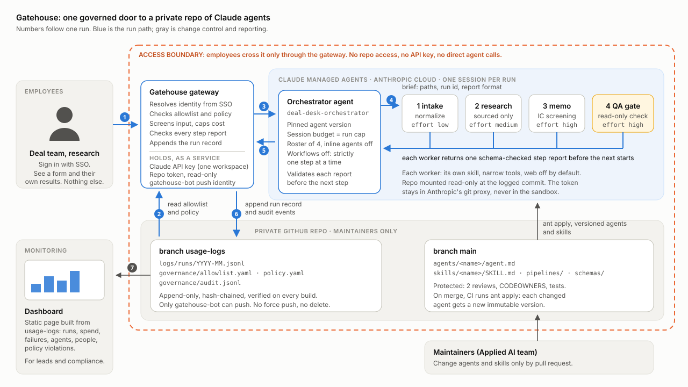
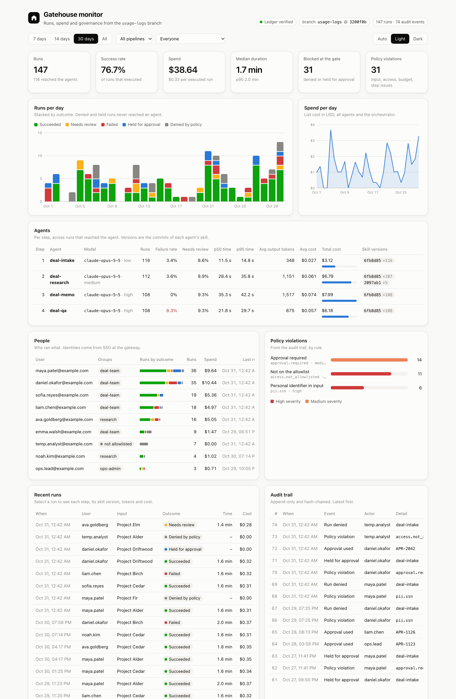
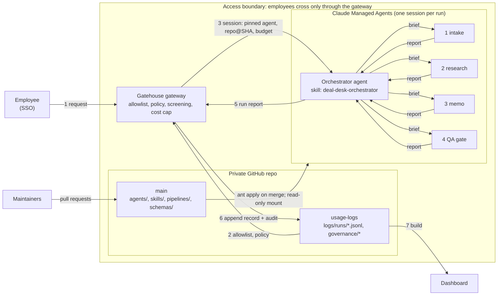

# Gatehouse

One governed door to a private repo of Claude agents.



*Rendered PNG: [docs/architecture.png](docs/architecture.png). A Mermaid version is at the end of this file.*

Employees talk to a single orchestrator. The orchestrator runs worker agents from a private repo one
step at a time, and checks each structured report before the next step starts. Every run is written to
an append-only, hash-chained ledger on a `usage-logs` branch of the same repo, next to the allowlist,
the policy and the audit trail. A dashboard is built from that branch.

The example pipeline is a private-markets deal desk: **intake → research → memo → QA**. All people,
deals and figures in this repo are synthetic.



---

## Contents

- [Try it in two minutes](#try-it-in-two-minutes)
- [What is in the repo](#what-is-in-the-repo)
- [How one run works](#how-one-run-works)
- [Where the orchestrator runs, and why](#where-the-orchestrator-runs-and-why)
- [Access model](#access-model)
- [The usage-logs branch](#the-usage-logs-branch)
- [Daily ledger audit and alerts](#daily-ledger-audit-and-alerts)
- [Governance](#governance)
- [Dashboard](#dashboard)
- [Running in the cloud](#running-in-the-cloud)
- [Design decisions](#design-decisions)
- [What is simulated, and what is not](#what-is-simulated-and-what-is-not)

## Try it in two minutes

The dry run exercises the whole flow offline: allowlist and policy checks, the sequential orchestrator,
real artifacts passed between steps, schema validation, the QA gate, cost accounting and real commits
to the `usage-logs` branch. It makes no API calls.

```bash
python3 -m venv .venv && . .venv/bin/activate
pip install -e '.[dev]'
```

```bash
gatehouse ledger init                      # create the usage-logs branch with the seed governance files
```

```bash
gatehouse run deal-intake --input examples/deals/alder-industrial-services.json --user maya.patel@example.com
```

```
run_20261030_2f2c5c32  SUCCEEDED  user=maya.patel@example.com  cost=$0.31
  1. deal-intake    ok              10.9s  $0.025  6fb8d85958  Normalized Project Alder: private_equity, industrial services, $180.0M.
  2. deal-research  ok              28.5s  $0.049  2097ab1590  3 comparables, 3 risks, 2 open questions; web tools off, reference notes only.
  3. deal-memo      ok              31.3s  $0.069  6fb8d85958  Memo written; recommendation: Advance to diligence.
  4. deal-qa        ok              21.1s  $0.057  6fb8d85958  All checks passed.
  memo: .gatehouse/runs/run_20261030_2f2c5c32/memo.md
```

The hash after each step is the commit of that agent's skill. Here `deal-research` shows a newer commit
than the others because its skill was revised after the first commit; the dashboard's Agents table shows
both versions and how many runs used each.

Try the paths that should not succeed:

```bash
gatehouse run deal-intake --input examples/deals/fir-blocked-pii.json --user maya.patel@example.com        # denied: SSN in input
```

```bash
gatehouse run deal-intake --input examples/deals/driftwood-digital-infra.json --user maya.patel@example.com # held: over $500M, needs --approval
```

```bash
gatehouse run deal-intake --input examples/deals/birch-healthcare-credit.json --user liam.chen@example.com --inject-failure deal-memo:figure_mismatch   # QA gate fails the memo
```

```bash
gatehouse run deal-intake --input examples/deals/alder-industrial-services.json --user temp.analyst@example.com  # denied: not on the allowlist
```

Then look at what was recorded and build the dashboard:

```bash
gatehouse verify                           # hash chains intact, nothing rewritten
```

```bash
gatehouse seed --days 30 --runs 140        # optional: a synthetic month of runs through the same gateway
```

```bash
gatehouse dashboard && open dashboard/dist/index.html
```

Other commands: `gatehouse registry` lists every agent with its skill's commit and tree hash;
`gatehouse grant` / `gatehouse revoke` change the allowlist (admins only, audited). Tests: `pytest -q`.

## What is in the repo

```
agents/
  orchestrator/agent.md       the only agent employees reach; its roster is the four workers below
  deal-intake/agent.md        each worker: model, effort, narrow tool set, one skill
  deal-research/agent.md
  deal-memo/agent.md
  deal-qa/agent.md
skills/
  deal-desk-orchestrator/SKILL.md   the orchestrator's procedure: order, briefs, validation, stop rules
  deal-intake/SKILL.md  deal-research/SKILL.md  deal-memo/SKILL.md  deal-qa/SKILL.md
environments/deal-desk.yaml   cloud sandbox, limited networking, no outbound hosts
pipelines/deal-intake.yaml    step order, what each step consumes and produces, the gate, run limits
schemas/step-result.schema.json   the report every worker returns
governance/seed/              first version of allowlist.yaml and policy.yaml for the usage-logs branch
gatehouse/                    the gateway, ledger, policy engine, orchestrator reference, backends, CLI
dashboard/template.html       the dashboard page; `gatehouse dashboard` fills in the data
examples/                     synthetic deals and synthetic sector notes
tests/                        offline tests (no API, no network)
```

`agents/` and `skills/` use the file format of [`ant apply`](https://platform.claude.com/docs/en/managed-agents),
the Claude CLI's way of keeping Managed Agents resources in version control: YAML frontmatter is the
agent config, the Markdown body is its system prompt, and `skills: [../../skills/<name>]` attaches the
skill directory. The same files drive the dry run, so there is one definition of each agent.

## How one run works

The numbers match the diagram.

1. **Request.** An employee submits a deal to the gateway. Their identity comes from SSO; the CLI's
   `--user` stands in for it locally.
2. **Policy.** The gateway reads `governance/allowlist.yaml` and `governance/policy.yaml` from the
   `usage-logs` branch (never from `main`, so a pull request cannot widen its own access). It checks
   group membership, the daily quota, input screening (personal identifiers, account numbers, MNPI
   markers, restricted-list names) and approval rules. A failed check ends the run here: no agent ever
   sees the input, and the denial is logged and audited.
3. **Session.** The gateway starts one Managed Agents session of the orchestrator agent, with a hard
   list-cost budget equal to the run cap and this repo mounted read-only at the exact commit it logs.
4. **Steps, one at a time.** The orchestrator follows its skill: brief the worker for step N with the
   paths it needs, wait for its report, validate it against `schemas/step-result.schema.json`, ask once
   for a corrected report if it is invalid, stop if the step failed, then move to step N+1. The QA step
   is the gate: `needs_review` there becomes the run's outcome, `failed` fails the run.
5. **Run report.** The orchestrator returns one run report. The gateway checks each step report again
   against policy (for example a `pii.present` issue from a worker is a violation).
6. **Ledger.** The gateway appends the run record and any audit events to `usage-logs` in one commit.
7. **Dashboard.** A build job reads `usage-logs`, verifies it, and publishes the static dashboard.

[`gatehouse/orchestrator.py`](gatehouse/orchestrator.py) is the same procedure as the orchestrator
skill, written in code. The dry run uses it; the tests check its rules (order, retry, stop, gate, budget).

## Where the orchestrator runs, and why

The requirement: one orchestrator in the cloud, agents and skills versioned in a private repo,
employees reach only the orchestrator. Three Claude surfaces could host it.

| | Claude Managed Agents | Scheduled or cloud Claude Code routine | Org-shared skill in Claude apps |
|---|---|---|---|
| Who triggers a run | Any caller of your gateway, on demand | A schedule, or the routine's owner | Each employee, in their own client |
| Whose credentials run it | A service identity you control | The routine owner's | Each employee's |
| Can employees read the agent and skill text | No, if they have no repo or Console access | No | Yes: a shared skill is readable by the people it is shared with |
| Versioning | Every agent update is an immutable version; sessions pin one | The repo at run time | Skill versions, no pinning per run |
| Per-run spend cap | Session budget, enforced before every model request | The owner's plan limits | Each user's plan limits |
| Central log of every run | Yes, the gateway sees every session | Per routine | No: runs happen in each user's own client |
| Multi-agent, sequential | Coordinator with a fixed roster of agents | One agent | One agent |

**Choice: Claude Managed Agents.** It is the only option where a service identity, not the employee,
holds the credentials, so "employees only touch the orchestrator" can be enforced rather than requested.
It also gives versioned agents, a per-session sandbox, a hard dollar budget per run, and a git proxy that
keeps the repo token out of the sandbox. A routine fits scheduled jobs that one owner runs; an org-shared
skill fits personal productivity, where reading the skill is fine and central logging is not required.

How the requirement maps onto it:

- **Orchestrator as a skill.** `agents/orchestrator/agent.md` is a short system prompt that loads
  `skills/deal-desk-orchestrator`, where the actual procedure lives.
- **Agents in the private repo, each with its own skill.** One `agents/<name>/agent.md` and one
  `skills/<name>/SKILL.md` per worker. On merge to `main`, CI runs `ant apply`, which updates each
  changed agent in place (a new immutable version) and records IDs in `claude-lock.json`.
- **Sequential, with reports.** The orchestrator's `multiagent` block lists exactly four agents with
  inline agents disabled, and dynamic workflows disabled, so it cannot fan out or invent helpers. The
  skill makes it wait for and validate each report.

## Access model

Employees get exactly one capability: submit a request to the gateway and see their own results.

| Party | Can do | Holds | Cannot do |
|---|---|---|---|
| Employee | Submit a run through the gateway (web form, Slack command or CLI behind SSO); see own results | An SSO session | Read the repo; call the Claude API; see or call a worker agent; see other people's runs |
| Gateway (service) | Check policy; start sessions of one agent; append to `usage-logs` | A Claude API key scoped to one workspace (or workload identity federation); a fine-grained repo token with **Contents: Read**; the `gatehouse-bot` GitHub App for pushes | Change `main`; change agents; push anything but fast-forward appends to `usage-logs` |
| Orchestrator session (sandbox) | Read the repo at one commit; delegate to its four workers | Nothing: the repo token is injected by Anthropic's git proxy after requests leave the sandbox | Call agents off its roster; reach the internet (no allowed hosts, web tools off) |
| Maintainers (Applied AI team) | Change agents, skills, pipelines by pull request | Repo write access | Merge without two reviews and green CI; push to `usage-logs` |
| Leads and compliance | Read the dashboard | Access to wherever the dashboard is hosted | Change anything |
| Admins (`admins:` in the allowlist) | Grant and revoke groups through `gatehouse grant` | Admin role at the gateway | Edit governance files directly |

How each line is enforced:

- **The repo is private** and only maintainers are collaborators. Employees are not in the GitHub org's
  team for it. (This public copy exists to show the design; in use, it is a private repo.)
- **Repository rules on `main`:** pull request required, two approving reviews, CODEOWNERS review for
  `agents/`, `skills/`, `pipelines/`, `schemas/`, `governance/`, required checks `tests` and
  `ant-apply-dry-run`, no force pushes.
- **Repository rules on `usage-logs`:** only the `gatehouse-bot` app may push; no force pushes; no
  deletion. A daily audit fails and raises an alert if the branch is edited or rewritten anyway (see
  [Daily ledger audit and alerts](#daily-ledger-audit-and-alerts)).
- **Claude workspace:** the deal-desk agents live in their own workspace. Only the gateway's key and
  the CI key can use it; Console access for that workspace is limited to maintainers, who use the
  session viewer for debugging.
- **Workers are unreachable on their own:** the gateway only ever creates sessions of the orchestrator
  agent ID. Workers exist as Managed Agents objects but no employee-facing path references them, and the
  orchestrator's roster is fixed with inline agents disabled.

## The usage-logs branch

```
README.md
governance/allowlist.yaml     who may run which pipeline (changed only with an audit event)
governance/policy.yaml        budgets, approvals, input screening (changed only with an audit event)
governance/audit.jsonl        denials, policy violations, approvals, allowlist changes
logs/runs/YYYY-MM.jsonl       one record per run
```

It shares no history with `main` (it starts as an orphan branch), so checking out `main` never pulls
in logs, and log commits never trigger agent deploys.

One run record, trimmed:

```json
{
  "schema": "gatehouse.run/v1", "seq": 140, "run_id": "run_20261030_2f2c5c32",
  "pipeline": "deal-intake", "user": "maya.patel@example.com", "groups": ["deal-team"],
  "surface": "dry-run", "simulated": true,
  "started_at": "2026-10-30T23:42:44+00:00", "ended_at": "2026-10-30T23:44:20+00:00", "duration_ms": 96798,
  "status": "succeeded", "repo_commit": "3647bd30ff…",
  "orchestrator": {"agent": "deal-desk-orchestrator", "skill_commit": "6fb8d85958…", "skill_tree": "aaa43af124…"},
  "input": {"ref": "examples/deals/alder-industrial-services.json", "sha256": "sha256:…", "summary": "Project Alder, private_equity, industrial services, US Midwest"},
  "steps": [
    {"index": 1, "agent": "deal-intake", "model": "claude-opus-5-5", "effort": "low",
     "skill": "deal-intake", "skill_commit": "6fb8d85958…", "skill_tree": "a6104cfd21…",
     "status": "ok", "attempts": 1, "duration_ms": 10854,
     "tokens": {"input": 776, "output": 376, "cache_read": 2790, "cache_write": 2790},
     "cost_usd": 0.025, "summary": "Normalized Project Alder: …", "issues": [], "output_digest": "sha256:…"}
  ],
  "tokens": {"input": 23847, "output": 6350, "cache_read": 58783, "cache_write": 14841},
  "cost_usd": 0.31, "errors": [],
  "policy": {"decision": "allow", "max_cost_usd": 6.0, "violations": []},
  "prev_hash": "sha256:…", "hash": "sha256:…"
}
```

What makes it trustworthy:

- **Versions.** Each step records the commit that last touched its skill and the git tree hash of the
  skill directory, plus the repo commit the session was pinned to. Given a run ID you can check out
  exactly what ran.
- **Append-only.** The gateway writes with git plumbing into a temporary index (the working tree is never
  touched) and moves the branch with a compare-and-swap `update-ref`, so two writers cannot overwrite each
  other. `gatehouse verify` walks every commit and fails if any log or audit file was changed other than
  by appending, if a file was deleted, or if a governance file changed without an audit event in the same
  commit.
- **Hash-chained.** Each record carries `seq`, `prev_hash` and `hash` (SHA-256 over canonical JSON), so
  editing a line breaks the chain. Someone who rewrites git history and recomputes every hash is caught
  by the audit checkpoints below.
- **Data minimization.** Inputs and outputs are logged as a SHA-256 digest plus a one-line summary,
  never in full. Screening violations never copy the matched value.

## Daily ledger audit and alerts

[`.github/workflows/ledger-audit.yml`](.github/workflows/ledger-audit.yml) audits `usage-logs` every day
at 06:00 UTC, on demand, and whenever the ledger code changes. It runs from `main`, because
`usage-logs` shares no history with `main` and carries no workflow files that an editor could disable.

Each run does three things:

1. **Verify.** `gatehouse verify --since <last checkpoint>` fails if any line in `logs/runs/*.jsonl` or
   `governance/audit.jsonl` was edited, reordered or deleted (hash chain and append-only diff of every
   commit), if a governance file changed without an audit event, or if the last audited commit is no
   longer part of the branch, which means the history was rewritten after that audit.
2. **Checkpoint.** On a clean result it tags the audited tip as `ledger/verified-YYYYMMDDTHHMMZ`. A
   tag ruleset stops those tags from being moved or deleted, so a rewrite cannot also erase the evidence.
3. **Alert.** On failure the job fails, and it opens an issue labeled `ledger-alert` with the verify
   output, the branch tip and the last good checkpoint (or comments on the open one). GitHub notifies
   the repository's watchers of the new issue, and emails a failed scheduled run to whoever last changed
   the schedule. Point a Slack or email integration at the `ledger-alert` label to route it further.

Protection configured on this repository (GitHub rulesets):

| Ruleset | Target | Rules | Who can bypass |
|---|---|---|---|
| `usage-logs-append-only` | branch `usage-logs` | no deletion, no force push, updates restricted | repository admins (add the `gatehouse-bot` app in production) |
| `main-protection` | branch `main` | no deletion, no force push | repository admins |
| `ledger-checkpoints` | tags `ledger/*` | no deletion, no moving | nobody |

The rules stop most edits; the audit catches the ones made by someone who can bypass them.

To see the alert path work, edit one character of a record on a scratch copy of the branch and run
`gatehouse verify --since <tag>`; the tests in [`tests/test_ledger.py`](tests/test_ledger.py) do the
same for line edits, governance edits and history rewrites.

## Governance

**Allowlist** (`governance/allowlist.yaml`): groups map to pipelines and a daily run limit; users map to
groups. Changes go through `gatehouse grant --actor <admin> --user <email> --group <group>`, which
rewrites the file and appends a `governance.changed` event with before and after in the same commit.

**Policy** (`governance/policy.yaml`):

| Rule | Effect |
|---|---|
| `budgets.default_max_cost_usd` | Per-run cap. Becomes the Managed Agents session budget, so the platform stops new model requests at the cap. |
| `approvals` | `deal-intake` over $500M is held as `pending_approval` until rerun with an approval ticket. |
| `input_screening` | SSN-like numbers, account numbers, MNPI markers and restricted-list names block the run before any agent sees it. |
| `step_issues` | Issue codes in a worker report that count as violations (`pii.present`, `claim.unsupported`). |
| `logging` | Digest and summary only; seven-year retention. |
| `change_control` | Documents the GitHub rules above, and the dashboard shows them. |

**Audit trail** (`governance/audit.jsonl`): `run.denied`, `run.held_for_approval`, `policy.violation`,
`approval.used`, `governance.changed`, `ledger.initialized`. Hash-chained like the run log.

## Dashboard

`gatehouse dashboard` writes one static HTML file with the ledger inlined. It needs no server and reads
nothing at view time, so it can be hosted wherever the logs may be seen.

- Headline numbers: runs, success rate of executed runs, spend, median and p95 duration, runs blocked
  at the gate, policy violations.
- Runs per day by outcome, and spend per day.
- Per agent: runs, failure and review rates, p50 and p95 time, average output tokens, cost, and which
  skill versions ran.
- Per person: groups, runs by outcome, spend, last run.
- Policy violations by rule, the audit trail, and recent runs with each step expandable.
- The allowlist, policy and change-control rules in force, and whether the ledger verified.
- Filters for time range, pipeline and person; light and dark themes.

## Running in the cloud

This path is written against the documented Managed Agents API but has not been run against a live
account in this repo; the tests cover the dry-run path only.

1. Create a Claude workspace for the deal desk and an API key scoped to it.
2. Install the `ant` CLI (1.40.0 or later, for file paths in an agent's roster) and sync the definitions:
   ```bash
   ant apply --dry-run -v agents environments
   ```
   ```bash
   ant apply agents environments
   ```
   This creates the four workers, then the orchestrator with their IDs on its roster, uploads the five
   skills, creates the environment, and writes `claude-lock.json`. Commit it. From then on, CI does
   this on every merge to `main`.
3. Create a fine-grained GitHub token for this repo with **Contents: Read** only (for the session mount)
   and a GitHub App, `gatehouse-bot`, allowed by the `usage-logs` ruleset to push.
4. Run the gateway as a service behind SSO with:
   ```
   GATEHOUSE_ORCHESTRATOR_AGENT_ID   from claude-lock.json
   GATEHOUSE_ENVIRONMENT_ID          from claude-lock.json
   GATEHOUSE_REPO_URL                https://github.com/<org>/<repo>
   GATEHOUSE_REPO_READ_TOKEN         the read-only token
   ANTHROPIC_API_KEY                 the workspace key (or workload identity federation)
   ```
   and `pip install -e '.[cloud]'`. Runs then use `--backend managed`. After each append, the gateway
   pushes `usage-logs` (fast-forward only).
5. Schedule `gatehouse dashboard` (for example hourly in CI) and publish the output to an internal host.

[`gatehouse/backends/managed.py`](gatehouse/backends/managed.py) creates the session with the budget and
the pinned repo mount, streams events, denies any tool call that the `auto` permission policy cannot
decide (nobody is watching a gateway session), collects each worker's report from
`agent.thread_message_received`, and takes the run's cost from the session's `usage.list_cost`, which is
the platform's own figure.

## Design decisions

- **Workflows are off.** Managed Agents can let a coordinator start parallel workflow runs. This
  pipeline must be strictly sequential and auditable step by step, so `workflows` is disabled and the
  roster is fixed. To allow parallel research later, enable workflows on the orchestrator and say in
  its skill which step may use them.
- **Effort per agent, one model.** Every agent runs `claude-opus-5-5`; effort is set per role: intake
  `low`, research and orchestration `medium`, memo and QA `high`.
- **Web tools are off.** Research uses reference notes in the repo. Turning on `web_search` for
  `deal-research` means listing approved domains on the tool and in the environment's `allowed_hosts`.
- **Policy lives on the log branch.** A pull request to `main` cannot change who may run what; only
  an audited admin command can.
- **One retry for a bad report.** The orchestrator asks once for a corrected report, then fails the
  step. Repeated retries hide broken prompts and cost money.
- **QA is a gate, not an editor.** The QA agent has read-only tools and cannot fix the memo it judges.

## What is simulated, and what is not

| Real in the dry run | Simulated in the dry run |
|---|---|
| Allowlist, quota, screening and approval checks | The model calls: each worker is a rule-based stand-in for its skill |
| Sequential orchestration, retries, the QA gate, the budget gate | Token counts, estimated from the text each step would send and receive |
| Artifacts written by each step and read by the next | Durations, estimated from token counts |
| Skill versions from git | |
| Commits to `usage-logs`, hash chains, `verify` | |
| The dashboard | |

Every dry-run record has `"simulated": true`, and seeded history has `"origin": "seed"`.

## Mermaid version of the diagram


